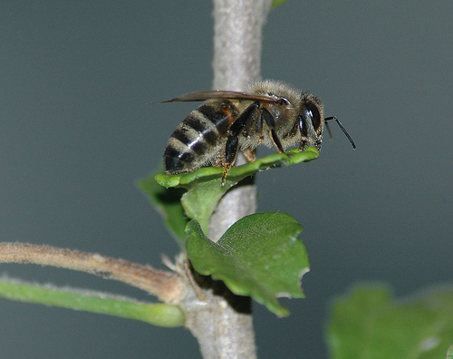

# Python ComfyUI 이미지→영상 배치 생성 (구형 모델)

[ComfyUI](https://github.com/comfyanonymous/ComfyUI) + **AnimateDiff**를 이용해
하나의 이미지에서 짧은 비디오 클립을 생성하고, 여러 시드(seed)로 **배치 생성**하는
Python 스크립트입니다. 구형(SD 1.5) 체크포인트와 구형 AnimateDiff 모션 모듈을 사용합니다.

- `img2vid_animatediff.py` — ComfyUI API를 호출해 이미지 → 비디오를 생성하는 단일 스크립트
- `batch_run.sh` — 시드 목록을 읽어 10개 클립을 순차적으로 배치 생성하는 셸 스크립트

> IPAdapter 없이 순수 AnimateDiff로 동작합니다. 입력 이미지를 latent로 인코딩해
> 프레임 수만큼 복제한 뒤 `denoise < 1.0`으로 샘플링해 원본 이미지와의 연속성을 유지합니다.

## 샘플 결과

아래는 이 저장소에 포함된 샘플 입력 이미지와 생성된 출력 영상입니다.

**입력 이미지**



**출력 영상** (16프레임 / 8fps / 20스텝)

<video controls src="output_06_seed2070229165.mp4"></video>

파일 다운로드: [output_06_seed2070229165.mp4](output_06_seed2070229165.mp4)

## 준비물 / 전제 조건

- Python 3 (3.10+ 권장)
- ComfyUI가 설치되어 있고 API(`127.0.0.1:8188`)로 접근 가능해야 합니다
- 아래 커스텀 노드가 설치되어 있어야 합니다
  - **ComfyUI-AnimateDiff-Evolved** — `ADE_AnimateDiffLoaderWithContext` 노드 제공
  - **ComfyUI-VideoHelperSuite** — `VHS_VideoCombine` 노드 제공
- 필요한 모델 파일
  - 체크포인트: `v1-5-pruned-emaonly.safetensors` (SD 1.5)
  - AnimateDiff 모션 모듈: `mm_sd_v15_v2.ckpt`

## 설치 절차

### 1. 저장소 클론

```bash
git clone https://github.com/bemoregt/python_Comfyui_img2video_batch_oldModels.git
cd python_Comfyui_img2video_batch_oldModels
```

### 2. ComfyUI 설치

아직 없다면 ComfyUI를 별도로 설치합니다. (이 저장소에는 대용량인 ComfyUI 설치본이 포함되어 있지 않습니다)

```bash
git clone https://github.com/comfyanonymous/ComfyUI.git
cd ComfyUI
# 가상환경 및 의존성 설치
python3 -m venv venv
./venv/bin/pip install -r requirements.txt
cd ..
```

### 3. 커스텀 노드 설치

`ComfyUI/custom_nodes/` 안에 커스텀 노드를 클론합니다.

```bash
cd ComfyUI/custom_nodes
git clone https://github.com/Kosinkadink/ComfyUI-AnimateDiff-Evolved
git clone https://github.com/Kosinkadink/ComfyUI-VideoHelperSuite
cd ../../
```

### 4. 모델 다운로드

모델 파일을 ComfyUI의 모델 폴더에 넣습니다.

```bash
# 디렉토리 생성
mkdir -p ComfyUI/models/checkpoints ComfyUI/models/animatediff_models

# SD 1.5 체크포인트 (약 4GB)
curl -L -o ComfyUI/models/checkpoints/v1-5-pruned-emaonly.safetensors \
  "https://huggingface.co/runwayml/stable-diffusion-v1-5/resolve/main/v1-5-pruned-emaonly.safetensors"

# AnimateDiff 모션 모듈 (약 1.7GB)
curl -L -o ComfyUI/models/animatediff_models/mm_sd_v15_v2.ckpt \
  "https://huggingface.co/guoyww/animatediff/resolve/main/mm_sd_v15_v2.ckpt"
```

> 디스크 용량이 충분하다면 HF CLI(`pip install huggingface_hub && huggingface-cli download ...`)를 사용해도 됩니다.

### 5. Python 스크립트 의존성 설치

```bash
pip3 install requests websocket-client
```

### 6. ComfyUI 서버 실행

```bash
cd ComfyUI
./venv/bin/python main.py --listen 127.0.0.1 --port 8188
```

서버가 뜨면 `http://127.0.0.1:8188` 에 접속해 정상 동작을 확인합니다.

## 사용법

### 단일 영상 생성

```bash
python3 img2vid_animatediff.py \
  --image example.jpg \
  --output output.mp4 \
  --seed 42
```

### 배치 생성

`batch_outputs/seeds.txt`에 원하는 시드를 한 줄씩 적고 스크립트를 실행합니다.

```bash
./batch_run.sh
```

10개 클립이 `batch_outputs/output_XX_seedXXXX.mp4` 형태로 생성됩니다.

## 주요 옵션

| 옵션 | 기본값 | 설명 |
| --- | --- | --- |
| `--image` | (필수) | 입력 이미지 경로 |
| `--output` | `output.mp4` | 저장할 비디오 경로 |
| `--server` | `127.0.0.1:8188` | ComfyUI 서버 주소 (`host:port`) |
| `--checkpoint` | `v1-5-pruned-emaonly.safetensors` | 체크포인트 파일명 |
| `--motion-module` | `mm_sd_v15_v2.ckpt` | AnimateDiff 모션 모듈 파일명 |
| `--prompt` | `best quality, smooth motion` | 긍정 프롬프트 |
| `--negative-prompt` | `worst quality, blurry, distorted, static` | 부정 프롬프트 |
| `--frames` | `16` | 생성할 프레임 수 |
| `--fps` | `8` | 비디오 프레임 레이트 |
| `--steps` | `20` | 샘플링 스텝 수 |
| `--cfg-scale` | `7.0` | CFG 스케일 |
| `--denoise` | `0.65` | 1.0에 가까울수록 원본에서 멀어짐 |
| `--seed` | `-1` (랜덤) | 시드 (고정 시 동일 결과 재현) |
| `--filename-prefix` | `animatediff_img2vid` | ComfyUI 내 임시 저장 파일 접두어 |

## 동작 방식

1. 입력 이미지를 ComfyUI 서버(`/upload/image`)에 업로드
2. AnimateDiff 기반 image-to-video 워크플로우를 API 형식으로 구성해 `/prompt`에 등록
3. WebSocket으로 해당 작업의 완료를 대기
4. `/history`에서 생성된 비디오 파일을 찾아 `/view`로 다운로드

## 주의사항

- 커스텀 노드 버전에 따라 `class_type` 이름이나 입력 파라미터가 달라질 수 있습니다.
  큐가 실패하면(HTTP 400 또는 ComfyUI 에러 로그) `img2vid_animatediff.py`의
  `build_workflow()` 내 노드 설정을 본인 ComfyUI 버전에 맞게 수정하세요.
- ComfyUI 메뉴의 **"Save (API Format)"**으로 실제 워크플로우를 export해서
  노드 이름을 비교하면 가장 정확합니다.
- Apple Silicon(MPS) 및 GPU/CPU 환경 모두에서 동작하지만, 생성 속도는 하드웨어에 따라 다릅니다.
